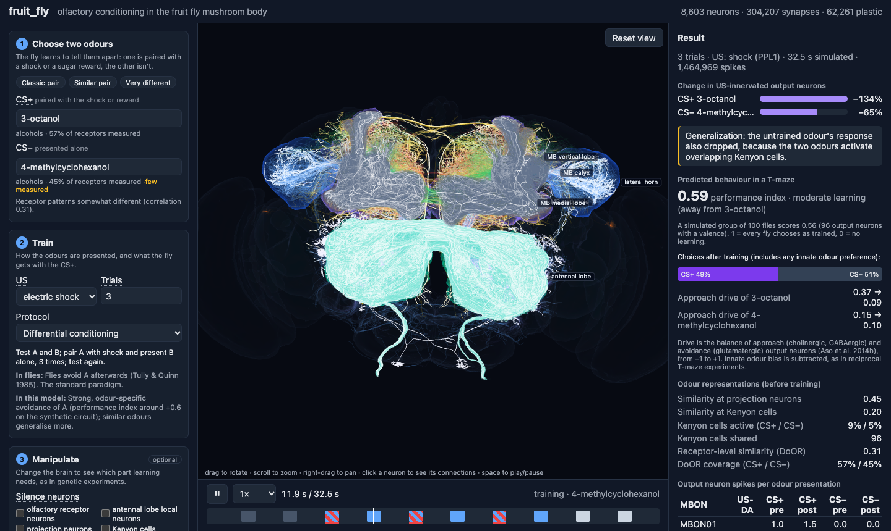
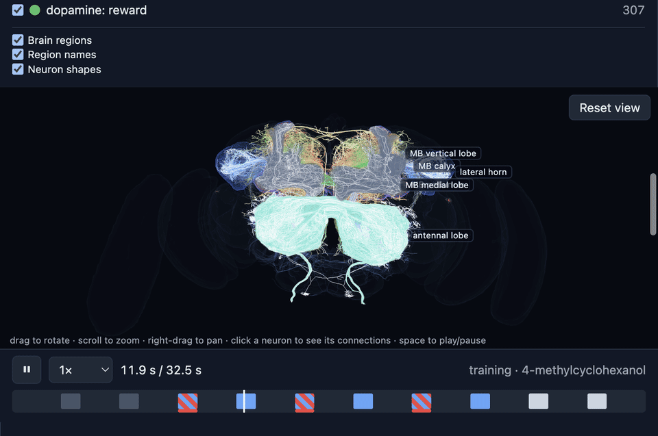
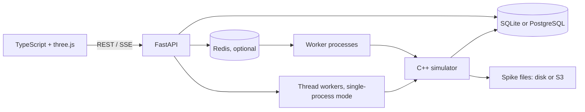

# fruit_fly

**A connectome-constrained model of olfactory conditioning in a fruit fly.**
`fruit_fly` runs a spiking mushroom-body circuit assembled from the real
FlyWire connectome, drives it with measured DoOR odour responses, and exposes
the experiment through a FastAPI service and a three.js 3D viewer.

An odour is presented with a shock or reward. Dopamine changes the synapses
from the active Kenyon cells to mushroom-body output neurons, and the model
turns the resulting output into a T-maze performance index. The web app lets
you watch the same process neuron by neuron.





This GIF is captured from the running FlyWire viewer while it replays recorded
spikes. The viewer
replays every recorded spike at full resolution.

## Live application

The real FlyWire circuit is available at
[fruit-fly.duckdns.org](https://fruit-fly.duckdns.org).

The demo is shared: users access the same FlyWire circuit and server, while
each browser maintains its own viewer state.

## What this project contains

| Layer | Role |
|---|---|
| **C++ simulator** | Leaky integrate-and-fire network of 8,603 neurons and about 766,000 connections, with dopamine-gated plasticity; a full-circuit experiment takes about 20 seconds on a typical machine. |
| **Python package** | pybind11 bindings, odour handling, experiment helpers, and a validation suite that runs the model against 12 published findings. |
| **FastAPI backend** | Experiment and parameter-sweep API, background jobs, SQLite or PostgreSQL persistence, Redis workers, cancellation, result reuse, exports, and live progress events. |
| **Web app** | TypeScript + three.js viewer with FlyWire anatomy, spike playback, odour selection, protocol presets, lesions, connection exploration, sweeps, and charts. |

## The circuit

The model follows the signal from odour to behaviour:

```text
odour
  │
  ▼
ORN ──► antennal-lobe local neurons ──► ALPN ──► KC ──► MBON ──► behaviour
                                                   ▲
                         APL inhibition ──────────┤
                         DPM modulation ──────────┤
                         DAN-PPL1 punishment ─────┤ dopamine
                         DAN-PAM reward ──────────┘
```

- **ORNs and ALPNs** carry measured receptor responses from DoOR 2.0.
- **Kenyon cells (KCs)** expand and sparsify the odour representation.
- **APL** provides feedback inhibition that keeps the KC code sparse.
- **DAN-PPL1 and DAN-PAM** carry punishment and reward teaching signals.
- **MBONs** read the learned value and determine approach versus avoidance.

The extractor keeps the parts of the FlyWire wiring relevant to olfactory
conditioning. It uses experimentally established MBON transmitters where
available, FlyWire image-based predictions for the remaining types, and
explicit anatomical rules for dendritic versus axonal inputs. The reasoning
behind each included group and each deliberate omission is documented in
[docs/mbon-transmitters.md](docs/mbon-transmitters.md)
and [docs/CIRCUIT.md](docs/CIRCUIT.md).

## Results: what the real circuit does and does not reproduce

Validation is deliberately run on the **real FlyWire circuit**, not only on
the synthetic circuit used for fast development. The current FlyWire report
passes **10 of 12** checks:

| Circuit | Checks passed |
|---|---:|
| Synthetic test circuit | 11 / 12 |
| **Real FlyWire circuit** | **10 / 12** |
| FlyWire, connections with at least 3 synapses | 9 / 12 |

The two real-circuit failures are part of the result, not hidden by retuning:
reward learning reaches a performance index of `+0.22` rather than the `+0.30`
target, and extinction does not yet reduce the learned response. The same run
passes sparse KC coding, pattern separation, odour-specific memory,
compartment-specific plasticity, acquisition, dopamine-neuron necessity, and
relief learning. See the full measured values in
[docs/validation/validation-flywire.md](docs/validation/validation-flywire.md)
and the interpretation in
[docs/validation/validation.md](docs/validation/validation.md).

The synthetic circuit is useful for testing the pipeline, but it is not
evidence about the fly. Calibration targets and pass/fail rules are documented
before the validation run; parameters are not tuned on the findings they test.

## How AI Was Used in This Project

This project was built in collaboration with Claude. I acted as an architect and reviewer, and delegated pieces of work to the AI, successfully completing a project that would take a team of engineers as a junior developer.

## Run locally

### Fastest: one container

The default image contains the synthetic circuit and DoOR data:

```bash
docker run --rm -p 8000:8000 fruit_fly
# open http://localhost:8000
```

Build it first with:

```bash
docker build -t fruit_fly .
```

### Full development stack

This starts PostgreSQL, Redis, the API, and two simulation workers:

```bash
docker compose up --build
# web app and API: http://localhost:8000
docker compose --profile monitoring up
# Prometheus: http://localhost:9090
# Grafana:    http://localhost:3000 (pre-provisioned Fruit Fly Overview dashboard)
```

For a local Python/frontend workflow:

```bash
python -m venv .venv
source .venv/bin/activate
pip install -e . -r backend/requirements-dev.txt
bash scripts/download_door.sh
python scripts/make_synthetic_mb.py
uvicorn backend.app.main:app --reload
```

In another terminal:

```bash
cd frontend
npm install
npm run dev
```

### Run the real FlyWire circuit

The FlyWire tables and neuron shapes are intentionally not committed. The
connectome download is about 270 MB; skeletons and anatomy add about 400 MB.
FlyWire data is licensed **CC BY-NC 4.0**, so this project and any public demo
using it must remain non-commercial and provide attribution.

```bash
bash scripts/download_data.sh
python scripts/extract_mb_circuit.py
python scripts/download_skeletons.py
python scripts/build_anatomy.py
```

Run the validation and create the calibrated parameter file:

```bash
python -m fruit_fly.validation \
  --circuit data/processed \
  --door data/raw/door \
  --calibrate \
  --params-out data/calibration-flywire.json \
  --out temp/validation-flywire.md
```

Then point the API at the real circuit:

```bash
FRUIT_FLY_CIRCUIT_DIR=data/processed \
FRUIT_FLY_PARAMS_FILE=data/calibration-flywire.json \
FRUIT_FLY_DOOR_DIR=data/raw/door \
uvicorn backend.app.main:app
```

The Docker build can perform the same data preparation in one image:

```bash
docker build --build-arg CIRCUIT=flywire -t fruit_fly:flywire .
```

Verify that the image really contains the real circuit and its anatomy before
opening a browser:

```bash
docker run --rm fruit_fly:flywire \
  python -c 'from pathlib import Path; import csv; p=Path("/app/data/flywire"); print(sum(1 for _ in csv.DictReader((p/"mb_neurons.csv").open()))); print((p/"mb_morphology.bin").stat().st_size)'

docker run --rm -d --name fruit-fly -p 8000:8000 fruit_fly:flywire
curl http://127.0.0.1:8000/api/health
curl http://127.0.0.1:8000/api/circuit
```

The first command must print `8603` and a morphology file of roughly 15 MB.
The health response must report `"neurons": 8603`; the circuit response must
report `"anatomy": {"regions": true, "morphology": true}`. Open
`http://127.0.0.1:8000`, not a Vite development server left over from a
different local circuit.

If the header says **2,126 neurons** or the viewer shows only dots, that
browser is not connected to this image: it is showing a different backend
(usually a synthetic or reduced local circuit), or it loaded a server built
before anatomy files were generated. Stop other `uvicorn`/Docker processes,
open the port from the `docker run` command, and hard-refresh the page. The
FlyWire image contains 8,603 neurons and the shapes are served by
`/api/circuit/morphology`.

## Architecture



The default Docker mode uses SQLite and in-process threads.
The compose deployment uses PostgreSQL, Redis, and separate workers. Jobs are
claimed atomically, migrations are protected against concurrent startup, live
progress is streamed with SSE (with polling fallback), and deterministic
requests can reuse an existing result.

## Repository layout

```text
core/       C++ simulator, CLI, and pybind11 bindings
fruit_fly/  Python package and validation suite
backend/    FastAPI app, queue, migrations, and backend tests
frontend/   TypeScript + three.js web app
scripts/    Data download, circuit extraction, anatomy, and curation tools
docs/       Circuit rationale, references, and validation reports
deploy/     Container deployment files and calibrated parameters
tests/      C++ and Python model tests
```

## Data, licensing, and references

- **Connectome and cell types:** FlyWire FAFB v783 (Dorkenwald et al. 2024;
  Schlegel et al. 2024, *Nature*), **CC BY-NC 4.0**.
- **Neuron skeletons and brain regions:** FlyWire v783 skeletons and neuropil
  meshes, with region naming following Ito et al. 2014.
- **Odour responses:** DoOR 2.0 (Münch & Galizia 2016), **CC BY-SA 4.0**.
- **Neuron parameters:** Shiu et al. 2024, *Nature*.
- **Mushroom-body architecture and transmitter curation:** Aso et al. 2014a
  and the sources listed in the project documentation.

See [docs/REFERENCES.md](docs/REFERENCES.md)
for the complete bibliography, data provenance, and the locations where each
study is used in the code. This repository does not redistribute the raw
FlyWire downloads.
